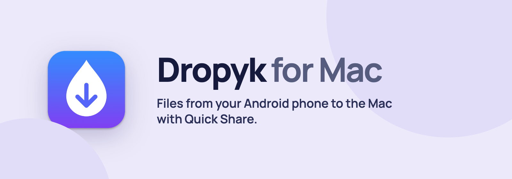
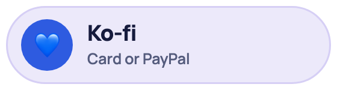
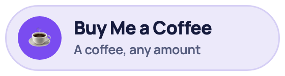
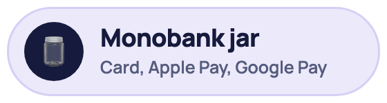

**English** · [Українська](README.uk.md)

Receive files from Android phones on your Mac with Quick Share. Dropyk lives in the menu bar and saves files to Downloads.

Works with any Android phone that has Quick Share, which is every phone with Google Play: Samsung, Pixel, Xiaomi, Motorola, OnePlus and others. The phone and the Mac just need to be on the same Wi‑Fi.

**[Download for macOS](https://github.com/Syvyj/dropyk-mac/releases/latest/download/Dropyk.dmg)** · **[Website](https://dropyk.syvyj.dev/)** · **[Installation](#installation)**

`macOS 12+` `Wi‑Fi LAN` `Unlicense`

On the TV, [Dropyk for Android TV](https://github.com/Syvyj/dropyk-android) receives from phones and from this Mac.

## Features

- **Accept automatically.** A menu bar toggle, *Accept transfers automatically*, skips the confirmation for every transfer. It accepts from anyone on your network, so turn it on only on a network you trust. Off by default.
- **Several files go into a folder.** A transfer with more than one file is saved to `~/Downloads/<device name> <date time>/`, and the folder opens in Finder when it's done. A single file goes straight to Downloads.
- **A notification when files arrive** — click it to see them in Finder. With automatic accepting, that's how you know something came.
- **Send to a TV.** In Finder or Safari, Share → Dropyk, then pick a TV running [Dropyk for Android TV](https://github.com/Syvyj/dropyk-android) (open, or receiving in the background). Files and links; accept on the TV.
- **Big files.** Long videos and hundreds of photos in one go.
- **Updates itself** from GitHub releases, see below.
- **English and Ukrainian.**

## Installation

1. Download [`Dropyk.dmg`](https://github.com/Syvyj/dropyk-mac/releases/latest/download/Dropyk.dmg), open it and drag Dropyk to Applications.
2. The app isn't signed with an Apple Developer ID, so the first time right-click it and choose **Open**, then confirm. Or run `xattr -dr com.apple.quarantine /Applications/Dropyk.app`.
3. When macOS asks, allow Dropyk to **find devices on your local network** — without it phones won't see the Mac — and to show **notifications**.
4. To start it with the Mac: *Open at Login* in Dropyk's menu (macOS 13+; on macOS 12: System Settings → Users & Groups → Login Items → add Dropyk).

On the phone: Share → Quick Share, and pick your Mac. The phone and the Mac must be on the same Wi‑Fi.

**Updates.** Dropyk checks GitHub on launch and once a day; a newer version shows *Update to Dropyk …* at the top of its menu, or use *Check for Updates…*. It downloads the new version, checks it against the release's checksum and its own signature, and restarts into it. Builds are signed with the same certificate every time, so macOS keeps Dropyk's permissions after an update.

## Support the author

Dropyk is free and will stay free. If it saves you time, you can buy me a coffee:

<p>
  <a href="https://ko-fi.com/syvyj"></a>
  <a href="https://buymeacoffee.com/syvyj"></a>
  <a href="https://send.monobank.ua/jar/5juJPj142b"></a>
</p>

## Why a fork

Dropyk is built on [NearDrop](https://github.com/grishka/NearDrop), which reverse engineered the Quick Share protocol and has nearly all of the code that makes this work. See the [protocol documentation](PROTOCOL.md). Dropyk adds the features above, its own name, icon and bundle ID (`com.dokboss.Dropyk`), and needs macOS 12 or later, because current Xcode no longer builds for 10.15. Don't run it together with NearDrop: both would show up on the network.

## Limitations

- **Wi‑Fi LAN only.** Wi‑Fi Direct, Bluetooth and the other transports Google uses are not supported.
- **Visible to everyone on your network** while the app is running.

## Building

```
scripts/make-signing-cert.sh   # once: the "Dropyk Local Signing" certificate in your keychain
scripts/make-release.sh        # build/release/Dropyk.dmg and Dropyk.dmg.sha256
```

A release carries both files; the in-app updater needs the checksum. Without the certificate you can still build an ad-hoc signed copy:

```
xcodebuild -project NearDrop.xcodeproj -scheme NearDrop -configuration Release -derivedDataPath build CODE_SIGN_IDENTITY=- CODE_SIGNING_REQUIRED=NO build
```

The README banners come from [`docs/banner.html`](docs/banner.html): `docs/render-banners.sh` (needs Google Chrome).

## License

[Unlicense](UNLICENSE), same as NearDrop.
