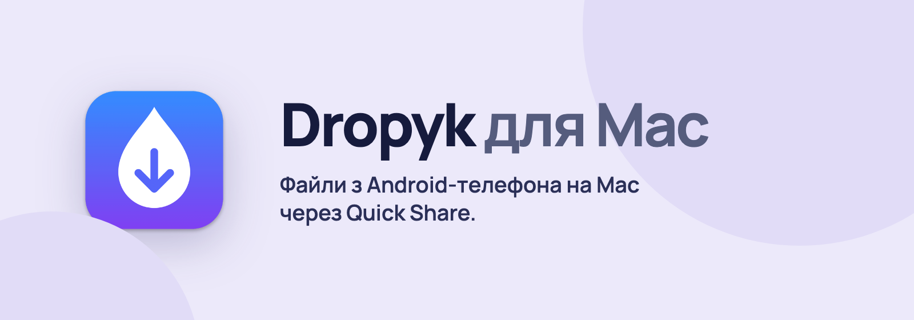
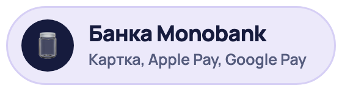
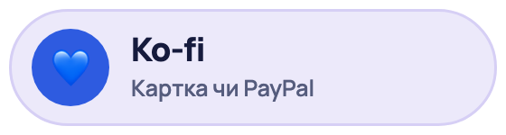
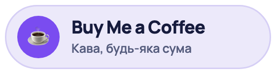

[English](README.md) · **Українська**

Приймайте файли з Android-телефонів на Mac через Quick Share. Dropyk живе в рядку меню й зберігає файли в «Завантаження».

Працює з будь-яким Android-телефоном, де є Quick Share, тобто з кожним, де є Google Play: Samsung, Pixel, Xiaomi, Motorola, OnePlus та іншими. Телефон і Mac мають бути в одній Wi‑Fi-мережі.

**[Завантажити для macOS](https://github.com/Syvyj/dropyk-mac/releases/latest/download/Dropyk.dmg)** · **[Сайт](https://dropyk.syvyj.dev/uk/)** · **[Встановлення](#встановлення)**

`macOS 12+` `Wi‑Fi LAN` `Unlicense`

Щоб надсилати на телевізор, є [Dropyk для Android TV](https://github.com/Syvyj/dropyk-android).

## Можливості

- **Автоприйом.** Перемикач у меню, *Приймати передачі автоматично*, прибирає підтвердження для кожної передачі. Приймає від будь-кого в мережі, тож вмикайте лише в мережі, якій довіряєте. За замовчуванням вимкнений.
- **Кілька файлів в окрему теку.** Передача з кількох файлів зберігається в `~/Downloads/<ім'я пристрою> <дата час>/`, і після завершення тека відкривається у Finder. Один файл іде просто в «Завантаження».
- **Великі файли.** Довгі відео й сотні фото за раз.
- **Оновлюється сам** з релізів на GitHub, див. нижче.
- **Українська й англійська.**

## Встановлення

1. Завантажте [`Dropyk.dmg`](https://github.com/Syvyj/dropyk-mac/releases/latest/download/Dropyk.dmg), відкрийте його й перетягніть Dropyk у «Програми».
2. Застосунок не підписаний сертифікатом Apple Developer ID, тож уперше клацніть на ньому правою кнопкою, виберіть **Відкрити** й підтвердьте. Або виконайте `xattr -dr com.apple.quarantine /Applications/Dropyk.app`.
3. Коли macOS спитає, дозвольте Dropyk **знаходити пристрої в локальній мережі** — без цього телефони не побачать Mac — і показувати **сповіщення**.
4. Щоб запускався разом із Mac: Системні параметри → Загальні → Об'єкти входу → додайте Dropyk.

На телефоні: Поділитися → Quick Share і виберіть свій Mac. Телефон і Mac мають бути в одній Wi‑Fi-мережі.

**Оновлення.** Dropyk перевіряє GitHub під час запуску й раз на добу; якщо є новіша версія, нагорі його меню з'являється *Оновити до Dropyk …*, або скористайтеся *Перевірити оновлення…*. Він завантажує нову версію, звіряє її з контрольною сумою релізу й зі своїм підписом і перезапускається вже в ній. Збірки щоразу підписані тим самим сертифікатом, тож macOS після оновлення зберігає дозволи Dropyk.

## Підтримати автора

Dropyk безкоштовний і таким лишиться. Якщо він вам зручний, можна пригостити кавою:

<p>
  <a href="https://send.monobank.ua/jar/5juJPj142b"></a>
  <a href="https://ko-fi.com/syvyj"></a>
  <a href="https://buymeacoffee.com/syvyj"></a>
</p>

## Чому форк

Dropyk побудований на [NearDrop](https://github.com/grishka/NearDrop): там розібрали протокол Quick Share і там майже весь код, завдяки якому це працює. Див. [опис протоколу](PROTOCOL.md). Dropyk додає можливості, описані вище, власну назву, іконку й bundle ID (`com.dokboss.Dropyk`) і потребує macOS 12 або новішої, бо сучасний Xcode більше не збирає для 10.15. Не запускайте разом із NearDrop: в мережі з'являться обидва.

## Обмеження

- **Лише Wi‑Fi у локальній мережі.** Wi‑Fi Direct, Bluetooth та інші способи, які використовує Google, не підтримуються.
- **Видно всім у вашій мережі**, поки застосунок запущений.

## Збірка

```
scripts/make-signing-cert.sh   # один раз: сертифікат «Dropyk Local Signing» у вашій «В'язці ключів»
scripts/make-release.sh        # build/release/Dropyk.dmg і Dropyk.dmg.sha256
```

У релізі мають бути обидва файли: вбудованому оновленню потрібна контрольна сума. Без сертифіката можна зібрати копію з ad-hoc підписом:

```
xcodebuild -project NearDrop.xcodeproj -scheme NearDrop -configuration Release -derivedDataPath build CODE_SIGN_IDENTITY=- CODE_SIGNING_REQUIRED=NO build
```

Банери для README робить [`docs/banner.html`](docs/banner.html): `docs/render-banners.sh` (потрібен Google Chrome).

## Ліцензія

[Unlicense](UNLICENSE), як і в NearDrop.
